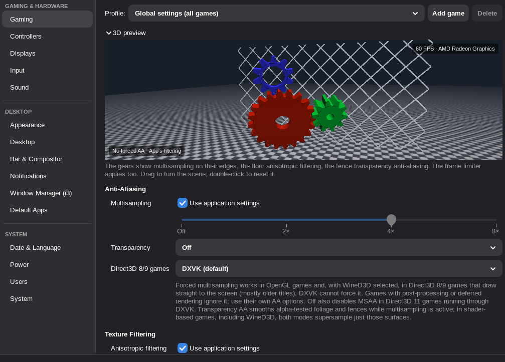

# XControl

A Catalyst-style control panel for **X11 on Linux**.

XControl brings back per-game graphics settings for Mesa drivers, and covers displays, input devices and PlayStation controllers. It also handles the parts of a desktop that a window manager like i3 leaves to you: theme, wallpaper, screen lock, bar, compositor, notifications, sound, power and users.



---

## Contents

- [Requirements](#requirements)
- [Installing](#installing)
- [Uninstalling](#uninstalling)
- [Getting started](#getting-started)
- [What's in it](#whats-in-it)
- [Files it uses](#files-it-uses)
- [Troubleshooting](#troubleshooting)
- [Limitations](#limitations)
- [Development](#development)
- [License](#license)

---

## Requirements

- **Arch Linux**, or a distribution that can build a `PKGBUILD`, running an **X11** session. XControl doesn't support Wayland.
- **Mesa** graphics drivers for the per-game graphics settings.
- **i3** is what the desktop pages are made for, but the gaming, display, input and controller pages work on any X11 desktop.
- The package pulls in what it needs: Python with GTK 3 (`python-gobject`, `python-cairo`, `gtk3`), `libepoxy`, `libglvnd`, the X libraries and the `xrandr`, `xinput`, `setxkbmap` and `xset` tools. Building needs `vulkan-headers` and `gettext`.
- **Optional extras** unlock individual features, such as vkBasalt, libratbag, PipeWire, polybar, picom and dunst. The `PKGBUILD`'s `optdepends` lists each one with what it's for.

The package is 64-bit only. That covers Proton games too, since Wine's WoW64 mode makes the Vulkan calls from 64-bit code. Native 32-bit Linux games won't load the GL shim and print a harmless `ld.so` warning.

## Installing

Clone the repository, then from its folder:

```sh
makepkg -si
```

## Uninstalling

```sh
sudo pacman -R xcontrol
```

Your settings stay in `~/.config/xcontrol`; delete that folder too if you won't be back. Also remove the `exec --no-startup-id xcontrol --session` line from your i3 config, and `xcontrol-run` from any game's launch options.

Some pages change system files, which uninstalling leaves in place. Set those settings back in XControl first, or delete the files by hand:

- `/etc/X11/xorg.conf.d/30-xcontrol.conf` and `00-xcontrol-driver.conf`: X options and the video driver ([X server](docs/x-server.md));
- `/etc/modprobe.d/xcontrol-*.conf`: kernel module options ([System](docs/system.md));
- `/etc/systemd/logind.conf.d/50-xcontrol.conf`: power buttons and lid ([Power](docs/power.md));
- a permanent EDID override: `/usr/lib/firmware/edid/xcontrol-*.bin`, plus the `drm.edid_firmware=` kernel parameter and mkinitcpio `FILES=` entry you added for it ([Displays](docs/displays.md)).

---

## Getting started

1. **Open XControl,** set the global settings, and use **Add game** for per-game profiles. Changes save automatically.
2. **Start games through the launcher:**
   - Steam: set the game's launch options to `xcontrol-run %command%`.
   - Anything else: `xcontrol-run /path/to/game`, or fill in **Command** in the profile and press **Launch**.
3. **On i3,** add one line to your i3 config so the display layout, input settings, wallpaper, bar, compositor, screen lock and the rest start at login:

   ```
   exec --no-startup-id xcontrol --session
   ```

System → **Check & Backup** tells you if something XControl relies on isn't running.

**Scrolling:** turning the mouse wheel over a dropdown, number field or slider scrolls the page instead of changing the setting. Number fields and sliders take the wheel once you've clicked into them.

**Title bar:** on GNOME-style desktops (GNOME, Pantheon, Budgie) XControl draws a GTK header bar. Everywhere else the window manager draws the title bar, and status messages appear at the bottom of the window. `XCONTROL_CSD=1` or `0` forces either style, and `XCONTROL_DECORATION` picks the header bar's buttons (for example `":close"`).

---

## What's in it

### Per-game graphics

| Setting | OpenGL | Vulkan | Wine / Proton (DXVK / VKD3D-Proton) |
|---|---|---|---|
| Anisotropic filtering Off, 2–16× | yes (shim) | yes (layer) | yes (layer + DXVK config) |
| Forced MSAA 2–8× | games that draw to the window directly | no | Direct3D 8/9 with the WineD3D renderer |
| MSAA Off | window MSAA | no | Direct3D 11 through DXVK |
| Transparency AA | alpha test (fixed-function or shader `discard`), while MSAA is active | no | WineD3D: yes; DXVK: supersample only, when the game uses MSAA |
| VSync off / on | `vblank_mode` | `MESA_VK_WSI_PRESENT_MODE` | DXVK sync interval |
| Fast sync / adaptive | no | yes | yes |
| Frame limiter | yes (shim) | yes (layer) | yes (layer) |
| FreeSync off / on | `adaptive_sync` | `adaptive_sync` | `adaptive_sync` (Vulkan) |
| Post-process AA (FXAA/SMAA), sharpening | no | vkBasalt | vkBasalt |

### The pages

Each page has its own documentation:

- **Gaming & Hardware:**
  - [Gaming](docs/gaming.md): per-game graphics, launching games, the live 3D preview, FreeSync, vkBasalt, MSAA for Direct3D 8/9 games.
  - [Displays](docs/displays.md): layout, scaling and color, night light, custom resolutions, the system-wide mode list, switching X drivers.
  - [Input](docs/input.md): mouse and touchpad, keyboard, gaming mice (libratbag).
  - [Controllers](docs/controllers.md): DualShock 4 and DualSense light bar, report rate, Xbox 360 emulation, remapping, touchpad gestures, gyro aiming, per-game layouts.
  - [Sound](docs/sound.md): renaming, hiding and keeping devices awake, the PipeWire sample rate and buffer.
- **Desktop:**
  - [Appearance](docs/appearance.md): themes, icons, cursor, fonts, sounds and animations.
  - [Desktop](docs/desktop.md): wallpaper, screen lock, screen power, starting at login.
  - [Bar & Compositor](docs/bar-and-compositor.md): polybar and picom.
  - [Notifications](docs/notifications.md): dunst and power alerts.
  - [Window Manager (i3)](docs/window-manager.md): the generated i3 config.
  - [Default Apps](docs/default-apps.md): what opens which file type, and the terminal.
- **System:**
  - [Date & Language](docs/date-and-language.md): time zone, clock, language and formats.
  - [Power](docs/power.md): idle sleep, power buttons and lid, power profile.
  - [Users](docs/users.md): accounts, groups, pictures.
  - [System](docs/system.md): system information, kernel modules, the session check and backups.
  - [X server](docs/x-server.md): loaded modules, X options, choosing the video driver.

The full documentation starts at [docs/](docs/README.md).

### Languages

XControl is translated into Brazilian Portuguese, Spanish, French, German and Russian. [Translations](docs/translations.md) explains how to add one.

---

## Files it uses

| File | |
|---|---|
| `~/.config/xcontrol/profiles.json` | Your global settings and per-game profiles. |
| `~/.config/xcontrol/` | The rest of XControl's settings and generated configs. |
| `~/.config/i3/config` | Your i3 config, which XControl's i3 page can generate. |

System → **Check & Backup** → **Save a backup…** writes all of XControl's settings, and the files it manages, to one JSON file. **Restore a backup…** puts them back.

## Troubleshooting

- **A setting doesn't reach a game:** start the game through `xcontrol-run` (see [Getting started](#getting-started)). The Gaming page shows which settings apply to which API.
- **Something stopped working after login:** check that `exec --no-startup-id xcontrol --session` is in your i3 config, then run System → **Check & Backup**, which finds what's missing and offers a fix.
- **A 32-bit Linux game prints an `ld.so` warning:** it's harmless. The GL shim is 64-bit only.
- **Forced MSAA does nothing:** see [Limitations](#limitations).

## Limitations

- **Forced MSAA** can't work for games that render through framebuffer objects (most games since about 2008), or for Vulkan games. That was also true of the Catalyst-era drivers. Use the game's own AA, or a post-process AA such as vkBasalt.
- **Transparency AA** finds alpha-tested shaders by looking for `discard`, the usual way to write an alpha test. Shaders that discard for other reasons get supersampled too: correct, but slower. Games that load precompiled SPIR-V shaders aren't detected.
- **Recent DXVK versions** can describe samplers through `VK_EXT_descriptor_heap` without calling `vkCreateSampler`. The `samplerAnisotropy` entries in `DXVK_CONFIG` cover that case for Direct3D 9 and 11.
- **DualSense** support hasn't been tested on real hardware yet; the DualShock 4 has.

---

## Development

`make check` runs the tests and the translation checks. [Translations](docs/translations.md) explains how to add a language, and [CHANGELOG.md](CHANGELOG.md) lists the changes.

## License

MIT, see [LICENSE](LICENSE).
