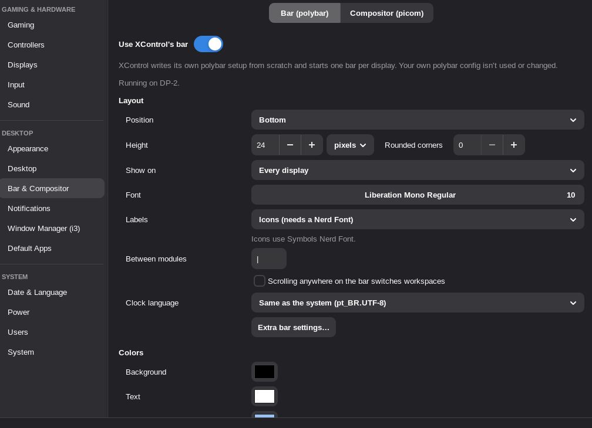

# Bar & Compositor

XControl can run polybar and picom for you, so their config files don't have to be written by
hand. It generates its own (`~/.config/xcontrol/polybar.ini` and `picom.conf`) from what you pick;
your own polybar and picom configs are neither used nor changed. Changes apply right away.

**Bar (polybar):** top or bottom, height, on every display or only the primary one, font, colors
(with a see-through background when a compositor runs), and the modules: i3 workspaces (polybar's
`internal/i3`), workspaces for other window managers (`internal/xworkspaces`, off by default), window
title, clock, CPU, memory, CPU temperature, volume, network, disk, keyboard layout, battery
(laptops) and the system tray, each on the left, center or right, in any order. Labels are words
(CPU, RAM, VOL) or icons when a Nerd Font is installed (e.g. `ttf-nerd-fonts-symbols`).
Every module has a gear button with its settings, e.g. for the i3 workspaces: name or number,
only this display's workspaces, urgent ones from other displays, hiding numbers ("1:web" →
"web"), sorting, click and scroll (wrapping, reversed), a separator, label spacing, and colors
for the current, other, shown-elsewhere and urgent workspaces and for i3 modes; the title's
length, clock formats and color, memory as percent or amount, network address, speed or name,
temperature in °C or °F, the volume step and what right-click runs (e.g. `alacritty -e wiremix`),
keyboard layout and Caps Lock, tray spacing and icon size. The bar has height in pixels or
points, rounded corners, the text between modules, scrolling anywhere to switch workspaces and
the language for dates.

Anything else polybar offers goes into **Extra polybar settings** (per module, and for the bar):
`key = value` lines that are added to that section and replace XControl's own line with the same
key. The generated file uses polybar's usual section names (`[module/i3]`, `[module/date]`,
`[module/pulseaudio]`, `[module/systray]`...). One bar runs per display, and the bars are
restarted when displays change; polybar picks up setting changes by itself.

**Compositor (picom):** backend (glx, xrender, egl), VSync, letting full-screen games skip the
compositor (lower input lag, and needed for FreeSync), shadows, fading, rounded corners, blur
behind see-through windows, and the opacity of focused and other windows. The generated file
only uses options that work from picom 9 to 12, and keeps the bar, the desktop, i3's frames,
menus and the lock screen free of effects.

Both are started by `xcontrol --session` and restarted if they crash; if one keeps failing, the
page shows why (e.g. a backend your driver doesn't support). The page also points out
`exec polybar`/`launch.sh`, `exec picom` lines and an i3 `bar { }` block in your i3 config, which
would start a second bar or compositor, and can stop ones that are already running.
