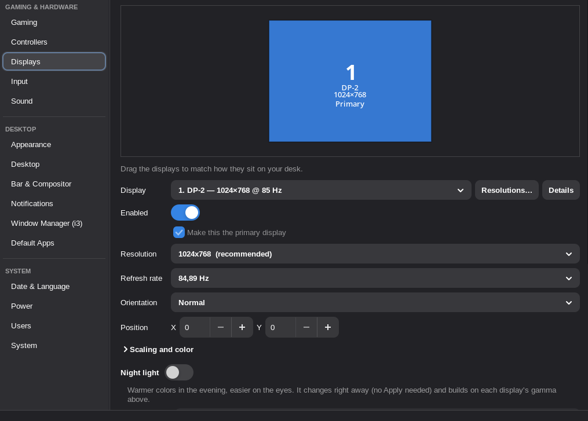

# Displays

The Displays page drives xrandr. You can drag monitors around (edges snap),
change resolution, refresh rate and rotation, set the primary display, and turn
outputs on or off. **Apply** asks you to confirm and reverts after 15 seconds
if you don't. **Restore this layout when I log in** adds an autostart entry
that runs `xcontrol --apply-display`. In a Wayland session xrandr can't
change outputs, so the page explains that and disables Apply.

## Scaling and color

The **Scaling and color** section under the display settings shows only what the X driver offers
for that output. xf86-video-amdgpu and modesetting both pass the kernel's connector properties
through, so on AMD you normally get all of them:

- **GPU scaling** (`scaling mode`): what happens when the resolution is below the display's
  native one: let the display scale, stretch, center without scaling, or scale keeping the aspect
  ratio.
- **Underscan** (`underscan`, plus border sizes): for TVs that crop the edges.
- **Output range** (`Broadcast RGB`): full 0–255 or limited 16–235, for gray blacks or crushed
  shadows on HDMI.
- **Color depth** (`max bpc`): the highest bits per color the link may use.
- **Saturation** (`CTM`): the display engine's color matrix, 0 % (grayscale) to 200 %, applied
  to everything on screen including games. It's the same idea as Catalyst's saturation slider or
  NVIDIA's "digital vibrance".
- **Gamma** (`xrandr --gamma`): night-light tools such as redshift also change gamma and win.

**Saturation** and **Gamma** change the screen live while you drag; leaving without Apply (or
closing the panel) puts the old colors back. Changes go through **Apply** with the usual
15-second revert. A saved layout only stores values
that differ from the driver's defaults, so they come back after X restarts.

## Night light

Warmer colors in the evening, set at the bottom of the Displays page and applied right away by
the desktop service (no Apply). **When**: from sunset to sunrise (the sun's position at your
location, which comes from the time zone unless you enter latitude and longitude), at set hours
with a gradual change, or all the time. **Night color** goes from 6000 K down to 1500 K, and
**Leave alone** skips displays you do color work on. It writes each display's gamma ramps
(RandR) on top of the gamma set above, so the two don't fight, re-applies them if another
program resets them, and puts normal colors back when it's turned off. From a key:
`xcontrol --night toggle` (on or off until the schedule next changes; also `on`, `off`, `auto`).
The page warns when redshift, gammastep or sct is running too.

## Custom resolutions and ignoring the EDID

**Resolutions…** on the Displays page opens a per-display editor:

- **Add a resolution:** width, height and refresh rate, plus a timing standard:
  - **CVT**: VESA's standard formula, CRT-style blanking.
  - **CVT reduced blanking (v1):** lower pixel clock, for LCDs and bandwidth-limited links.
  - **CVT reduced blanking v2:** hits the exact refresh rate; good for high refresh rates.
  - **GTF**: the classic CRT formula.
  - **DMT**: the fixed VESA table (640×480 at 60 Hz = 25.175 MHz, and so on). This
    matters for low resolutions, because CVT's 640×480 at 60 Hz is below the 25 MHz
    many HDMI links accept.
  - **Manual:** paste any modeline.

  The preview shows the modeline, pixel clock, horizontal frequency and actual
  refresh rate. It warns when a mode is outside the range the display reports or
  too slow for HDMI. **Classic modes** fills in 640×480, 800×600, 1024×768 and so on.
- **Offer only my resolutions for this display** hides the EDID's mode list, for
  displays whose EDID lists modes they can't really show.

New modes go to xrandr right away; pick one on the Displays page and press Apply
(with the usual 15-second revert). X forgets custom modes when it restarts, so the
panel re-creates them at login. The full layout is re-applied only when **Restore
this layout when I log in** is on.

All generators match `edid-decode` exactly (1,056 CVT/RB/RBv2/GTF timings and the
87-entry DMT table). Run `make check` to verify.

## System-wide mode list (EDID override)

The options above only change what the panel offers. Games and other programs read
the mode list from the kernel, which builds it from the display's EDID. **Resolutions…
→ System-wide mode list…** builds a corrected EDID that lists only the modes you tick:

- It keeps the display's name, serial number, size and colour data from its real EDID.
- A mode that matches an established timing sets that bit. A VESA (DMT) mode uses a
  standard-timing slot. Everything else is stored as an exact detailed timing, so
  your custom CVT, GTF or manual modes keep their exact timings.
- It clears the "continuous frequency / GTF" flag, so the kernel doesn't add extra
  modes on its own, and widens the range limits to cover your modes.
- If the display has a CTA-861 block (HDMI, audio, HDR), that data is kept; only its
  video modes are replaced.

Every generated EDID is checked against `edid-decode --check` in `make check`.

Buttons:

- **Save EDID file…** writes the EDID to a file.
- **Test now** loads it through the kernel's debugfs `edid_override` until the next
  reboot (asks for your password via polkit). **Undo test** restores the original.
- **Make permanent…** installs it to `/usr/lib/firmware/edid/` and shows what to add
  to your boot setup: the `drm.edid_firmware=` kernel parameter, and on Arch a
  mkinitcpio `FILES=` entry, because the kms hook loads the GPU driver from the
  initramfs. The panel never edits your bootloader or initramfs configuration itself.

The top of the dialog says whether the kernel is actually using the override, and if not,
what's missing: the kernel parameter (or one naming the wrong connector), the initramfs
`FILES=` entry, an initramfs built before the file last changed, or simply a pending
reboot. **Test now** always lasts only until the next reboot.

The only code that runs as root is `xcontrol-edid-helper`. It validates every
argument, accepts only real EDID files, and writes only to the connector's debugfs
override or `/usr/lib/firmware/edid/xcontrol-*.bin`.

## Switching X drivers

The same connector has a different X name depending on the driver: `DisplayPort-0` and
`HDMI-A-0` with xf86-video-amdgpu or xf86-video-ati, `DP-1` and `HDMI-1` with modesetting.
Custom resolutions, the "only my resolutions" choice and the saved layout are stored under
the X name, so when an output disappears and another appears on the same kernel connector,
the panel moves the saved settings over (on the Displays page and at login).

## Display details

**Details** on the Displays page opens what the selected display reports in its EDID,
plus what the driver exposes through xrandr:

- **Identity:** model, manufacturer, product code, serial number, manufacture date.
- **Panel:** native resolution, size, pixel density, color depth (with the driver's
  `max bpc` limit), gamma.
- **Refresh & sync:** highest refresh rate and resolution, supported refresh range,
  variable refresh rate (`vrr_capable` plus the FreeSync range).
- **Color & HDR:** HDR10/HLG/HDR10+/Dolby Vision, peak and full-frame brightness,
  gamut coverage of sRGB/DCI-P3/Rec. 2020 computed from the reported primaries,
  white point, wide-color signaling.
- **Connection:** X11 and kernel output names, current mode, input type, HDMI 2.0/2.1
  capability (TMDS clock, FRL bandwidth), audio, YCbCr formats, power saving.

**Copy details** copies a plain-text summary, and **Save EDID…** writes the raw EDID
for `edid-decode` or bug reports. The data comes from the kernel
(`/sys/class/drm`).

Keep in mind that this is what the monitor *claims*. Gamut and brightness figures in
EDIDs are often rounded or copied between models, so treat them as approximate.
