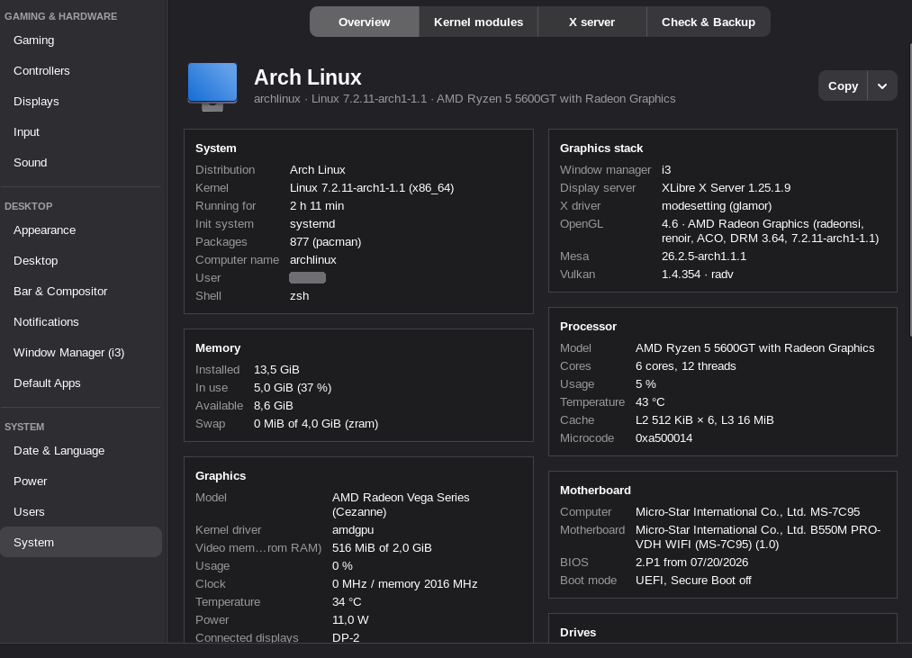

# System

The **System** page shows the distribution, kernel, uptime, package count, window manager,
X server and X driver (from the server's log), OpenGL, Mesa and Vulkan versions, the
processor (cores, cache, clock, frequency driver and policy, microcode), memory and swap,
each graphics card (model and card maker, kernel driver, video memory, and on amdgpu its
load, clocks, temperature and power), motherboard and BIOS, UEFI and Secure Boot, drives,
disk space, network adapters, sound cards and sound server, and every temperature and fan
sensor. Usage, clocks, temperatures and memory refresh every 2 seconds while the page is
open. Everything is read from `/proc` and `/sys` without root; OpenGL and Vulkan details
need `glxinfo` (mesa-utils) and `vulkaninfo` (vulkan-tools), and device names come from
hwdata.

**Copy** puts it on the clipboard as text, leaving out your computer and user names (the arrow
has **Copy in English** for bug reports). `xcontrol --sysinfo` prints the same text in a
terminal (`--sysinfo --english` for English).

## Kernel modules

The **Kernel modules** tab shows the kernel command line and every module that's loaded.
Search by module, device or parameter name; select one to see what it is (from `modinfo`), the
devices it drives, the modules that need it, each parameter with its current value and
description, and the `options`/`blacklist` lines about it in `/etc/modprobe.d` and
`/usr/lib/modprobe.d`. **Include parts built into the kernel** adds the built-in parts that
have parameters. A few parameters can only be read by root.

**Change…** next to a module's parameters sets values for every time the module loads. They're
saved in `/etc/modprobe.d/xcontrol-MODULE.conf` (XControl never edits other files there) by
`xcontrol-module-helper`, the second small root helper, run through pkexec like the EDID one.
It accepts only module and parameter names that exist and plain values (letters, digits and
`. , : + / - _`), and XControl checks each value against the parameter's type first. Leave a
field empty for the module's default; **Remove XControl's settings** deletes the file.

- **Also change it now** writes the value to `/sys/module/MODULE/parameters/` for the
  parameters the kernel allows changing while the module runs; the rest apply at the next load.
- **Rebuild the boot image** runs `mkinitcpio -P` (or dracut / update-initramfs). It's needed
  for modules that load from the initramfs, which carries its own copy of modprobe.d; XControl
  ticks it for modules listed in mkinitcpio's `MODULES` and for GPU drivers with the `kms` hook.
- Values set on the kernel command line (`amdgpu.ppfeaturemask=…`) win over modprobe.d; the
  dialog warns about those, and about other modprobe.d files setting the same parameter.
- Parts built into the kernel can't be set through modprobe.d; the page shows the command-line
  form instead.

## Session check and backups

System → **Check & Backup** looks at everything that quietly breaks other pages and offers a fix
where it can: whether `xcontrol --session` runs at login, whether the desktop service is up and
what keeps stopping, whether a **polkit agent** runs (on i3 nothing starts one, and then every
password prompt fails silently; it can start an installed agent and gives the line for your i3
config), extra bars, compositors, notification programs or locks running besides XControl's,
lines in your i3 config that start them twice, another night-light program, XSETTINGS for live
theme changes, notifications and sound.

**Save a backup…** writes one JSON file with all of XControl's settings plus the files it
writes that aren't regenerated from them (theme files, `mimeapps.list`, the terminal choice,
`locale.conf`, `~/.face`). **Restore a backup…** puts them back (keeping the current files as
`*.before-restore`; only those known files are ever written), applies them and restarts XControl.
