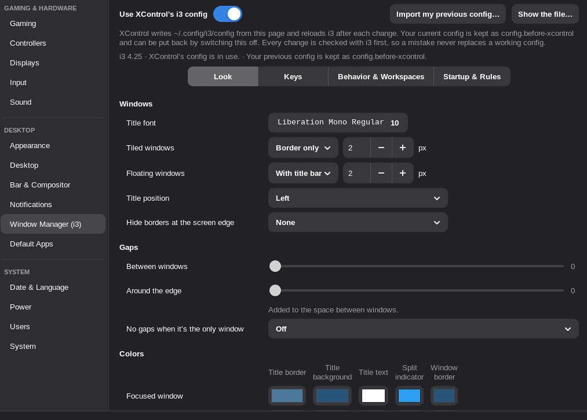

# Window Manager

The **Window Manager** page writes the config of the window manager you use: i3 or Openbox.
It shows the one that's running (when neither runs, the one that's installed; i3 if both are).
`xcontrol --page wm` opens it.

## i3

When **Use XControl's i3 config** is on, XControl writes `~/.config/i3/config` itself and reloads
i3 after every change. The config you had is moved aside as `config.before-xcontrol` (and
`~/.i3/config`, which i3 would otherwise read first, as `~/.i3/config.before-xcontrol`); switching
the page off offers to put it back. Every change is checked with `i3 -C` before it's written, so
a mistake shows up on the page as an error and never replaces a working config. **Show the file…**
shows (and copies) what's written.

The first time it's switched on you can start from i3's defaults or **import** your current config:
keys (with `$mod` and other variables resolved), modes, startup programs, window rules, workspace
names and displays, font, borders, gaps and colors come over; lines XControl now takes care of
(polybar/`launch.sh`, picom, feh, xss-lock, dunst, an i3 `bar { }`, each only when XControl runs
that part) are left out, and anything else lands in **Extra i3 config**.

- **Look:** title font, borders for tiled and floating windows, title position, hiding borders
  at the screen edge, gaps between windows and around the edge (and none for a lone window), and
  all of i3's window colors. On i3 4.24 and later, "no border for a lone window" is one of the
  hide-edge-borders choices (4.24 deprecated the separate `smart_borders`); older i3 gets the old
  form.
- **Keys:** the main key (Super or Alt, `$mod`), dragging windows, and every key binding in every
  mode, with search. Add or change a binding by typing it or pressing it (**Press keys…** grabs
  the keyboard, so even combinations i3 uses reach it). Keys used twice are shown in red.
- **Behavior & Workspaces:** focus follows the mouse, mouse warping, what happens when a window
  asks for attention, focus wrapping, where new windows go, new workspace layout, dialogs over
  full-screen windows, going back to the previous workspace, and a name and display for
  workspaces 1–10.
- **Startup & Rules:** programs started with i3 (or on every reload), window rules (`for_window`,
  `assign`; **Pick a window…** fills in a program's class with `xprop`), i3's own bar when
  XControl's bar is off, and **Extra i3 config** for anything else from i3's user guide.

`exec --no-startup-id xcontrol --session` is always in the generated file, so the wallpaper,
bar, compositor, screen lock and input settings start with i3.

## Openbox

When **Use XControl's Openbox config** is on, XControl writes `~/.config/openbox/rc.xml` and
`~/.config/openbox/autostart` itself and tells Openbox to reconfigure after every change (the
autostart file is read at the next login). The files you had are moved aside as
`rc.xml.before-xcontrol` and `autostart.before-xcontrol`; switching the page off offers to put
them back (or, if you had none, to go back to Openbox's defaults).

The first time it's switched on you can start from Openbox's own config (`/etc/xdg/openbox/rc.xml`)
or **import** yours. rc.xml is written from that file with the page's settings put in, so what the
page doesn't cover stays as it was: mouse bindings other than the two below, the menu file, the
dock, margins, the resize popup. Autostart lines for things XControl now runs (feh, picom,
polybar, dunst, xss-lock, ...) are left out, as on the i3 page.

- **Look:** the Openbox theme (folders with `openbox-3/themerc` in `~/.themes`, `~/.local/share/themes`
  or `/usr/share/themes`), the title bar's buttons, the title and menu fonts, keeping the border on
  windows without a title bar, and the minimize animation.
- **Keys:** the key to hold while dragging a window to move it (Alt or Super; the right button
  resizes), and every key binding, with search. A binding runs a command, does something to the
  window, switches desktops or shows a menu, or anything else Openbox can do as `<action>` XML.
  Chains (`C-a` then `t`) and bindings with several actions are kept and can be edited as XML.
  Keys used twice are shown in red; **Openbox's defaults** brings back Openbox's own bindings.
- **Behavior & Desktops:** focus follows the mouse (with a delay), raising the focused window,
  focusing new windows, where new windows open and on which display, how strongly windows stick
  to each other and to the screen's edges, what double-clicking the title does, whether clicking
  the desktop opens Openbox's menu (right button) or the list of windows (middle button), and how
  many desktops there are, their names and how long the name shows when switching.
- **Startup & Rules:** programs started at login (each goes to the background by itself; shell
  lines like `if`/`fi` are kept as they are), and window rules (`<applications>`): which windows
  (`class="Steam"`, `title="…"`, `role`, `name`, `type`) and what to do with them (`desktop=2`,
  `decor=no`, `maximized=yes`, `fullscreen=yes`, `layer=above`, `iconic=yes`, `skip_taskbar=yes`,
  `focus=no`, `x=center y=0 monitor=2`). **Pick a window…** fills in a program's class.

`xcontrol --session &` is always the first line of the generated autostart. Started with
`openbox-session`, Openbox also runs `~/.config/autostart`, where XControl's own entries are, so
the desktop service may be started twice; the second one exits right away.

LXDE starts Openbox with `~/.config/openbox/lxde-rc.xml` instead of `rc.xml`; the page says so when
the running Openbox reads another file.

i3 and Openbox each have their own bar settings: the Bar & Compositor page edits the one for the
window manager in use, and the first time, Openbox's starts as a copy of i3's. With Openbox, the
bar's **i3 workspaces** module is written as polybar's generic workspaces module, which works
with Openbox.
